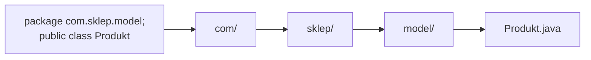
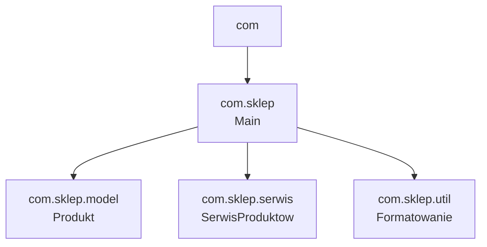
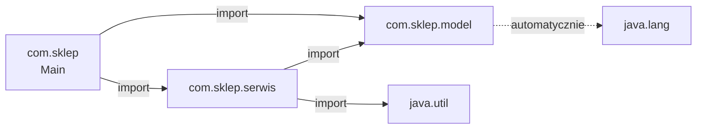
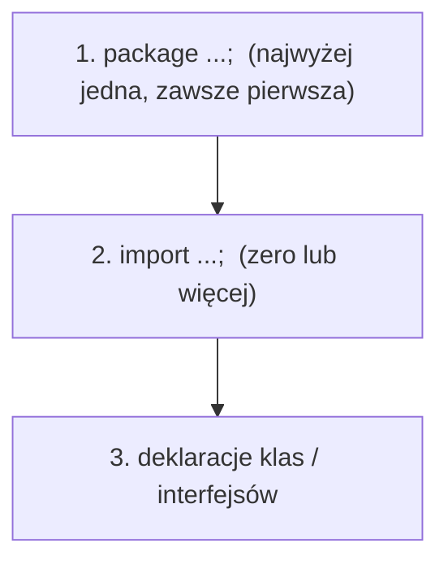
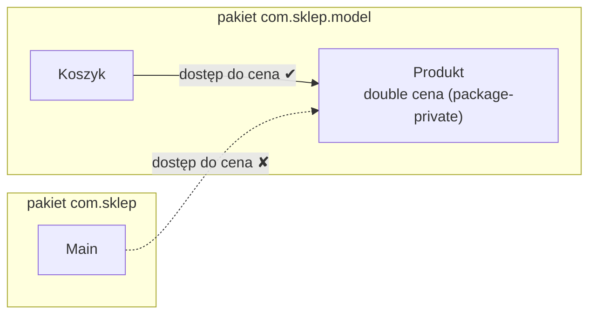
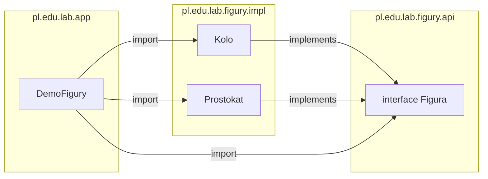
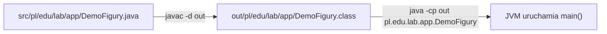

# 4. Modułowość. Pakiety. Mechanizm importowania klas.

## Teoria

### Czym jest modułowość?
Modułowość to zasada projektowania oprogramowania polegająca na dzieleniu programu na niezależne, wymienne moduły. Każdy moduł odpowiada za określoną funkcjonalność i komunikuje się z innymi modułami przez dobrze zdefiniowane interfejsy. W Javie modułowość realizowana jest przede wszystkim przez **pakiety** (packages).

### Pakiety w Javie
Pakiet (package) to mechanizm grupowania powiązanych klas i interfejsów. Pakiety pełnią następujące funkcje:
- **Organizacja kodu** — logiczne grupowanie klas o podobnej funkcjonalności.
- **Unikanie konfliktów nazw** — dwie klasy o tej samej nazwie mogą istnieć w różnych pakietach.
- **Kontrola dostępu** — modyfikatory dostępu współpracują z pakietami (np. dostęp pakietowy — domyślny).
- **Enkapsulacja na poziomie pakietu** — ukrywanie szczegółów implementacji.

### Deklaracja pakietu
Deklaracja pakietu musi być **pierwszą instrukcją** w pliku źródłowym (przed importami i deklaracjami klas):
```java
package com.firma.projekt.modul;
```

### Konwencja nazewnicza pakietów
- Nazwy pakietów pisane są **małymi literami**.
- Stosuje się odwróconą notację domenową: `com.firma.projekt`.
- Struktura pakietów odpowiada strukturze katalogów na dysku.

### Idea pakietów na rysunkach

**Deklaracja `package` wyznacza miejsce pliku na dysku:**



**Pakiety tworzą drzewo (ale podpakiet to osobny, niezależny pakiet):**



**Zależności (importy) między pakietami:**



**Kolejność elementów w pliku źródłowym:**



**Dostęp pakietowy (brak modyfikatora):**



### Mechanizm importowania klas
Import pozwala używać klas z innych pakietów bez podawania pełnej nazwy kwalifikowanej:

1. **Import konkretnej klasy:**
   ```java
   import java.util.ArrayList;
   ```

2. **Import wszystkich klas z pakietu (wildcard):**
   ```java
   import java.util.*;
   ```

3. **Import statyczny — import metod i pól statycznych:**
   ```java
   import static java.lang.Math.PI;
   import static java.lang.Math.*;
   ```

4. **Pełna nazwa kwalifikowana (bez importu):**
   ```java
   java.util.ArrayList<String> lista = new java.util.ArrayList<>();
   ```

### Pakiet `java.lang`
Pakiet `java.lang` jest importowany automatycznie — nie trzeba go jawnie importować. Zawiera klasy fundamentalne: `String`, `System`, `Math`, `Object`, `Integer`, `Double`, `Boolean`, itp.

### Najważniejsze pakiety standardowe
| Pakiet             | Zawartość                                      |
|--------------------|------------------------------------------------|
| `java.lang`        | Klasy podstawowe (String, Math, System, Object)|
| `java.util`        | Kolekcje, Scanner, Random, Date                |
| `java.io`          | Operacje wejścia/wyjścia na plikach            |
| `java.nio`         | Nowe API wejścia/wyjścia                       |
| `java.math`        | BigDecimal, BigInteger                         |
| `java.time`        | API daty i czasu (od Java 8)                   |
| `java.net`         | Programowanie sieciowe                         |
| `java.sql`         | Dostęp do baz danych (JDBC)                    |

### System modułów (Java 9+)
Od Javy 9 wprowadzono **Java Platform Module System (JPMS)**, który pozwala na definiowanie modułów za pomocą pliku `module-info.java`. Moduł deklaruje, które pakiety eksportuje i od jakich modułów zależy.

### Konflikty nazw
Gdy dwie klasy o tej samej nazwie pochodzą z różnych pakietów, należy użyć pełnej nazwy kwalifikowanej dla co najmniej jednej z nich:
```java
java.util.Date dataUtil = new java.util.Date();
java.sql.Date dataSql = new java.sql.Date(System.currentTimeMillis());
```

---

## Przykłady

### Przykład 1 — Deklaracja pakietu i podstawowy import
```java
package com.szkola.matematyka;

import java.util.Scanner;

public class KalkulatorMatematyczny {
    public double dodaj(double a, double b) {
        return a + b;
    }

    public double odejmij(double a, double b) {
        return a - b;
    }

    public static void main(String[] args) {
        Scanner scanner = new Scanner(System.in);
        KalkulatorMatematyczny kalk = new KalkulatorMatematyczny();

        System.out.println("2 + 3 = " + kalk.dodaj(2, 3));
        System.out.println("10 - 4 = " + kalk.odejmij(10, 4));

        scanner.close();
    }
}
```

### Przykład 2 — Import wielu klas z tego samego pakietu
```java
import java.util.ArrayList;
import java.util.HashMap;
import java.util.List;
import java.util.Map;

public class ImportWieluKlas {
    public static void main(String[] args) {
        // ArrayList z java.util
        List<String> lista = new ArrayList<>();
        lista.add("Java");
        lista.add("Python");
        lista.add("C++");

        // HashMap z java.util
        Map<String, Integer> mapa = new HashMap<>();
        mapa.put("Java", 1995);
        mapa.put("Python", 1991);
        mapa.put("C++", 1985);

        System.out.println("Lista języków: " + lista);
        System.out.println("Mapa języków: " + mapa);
    }
}
```

### Przykład 3 — Import z użyciem wildcard (*)
```java
import java.util.*; // importuje wszystkie klasy z java.util

public class ImportWildcard {
    public static void main(String[] args) {
        List<Integer> liczby = new ArrayList<>();
        Random random = new Random(42);

        for (int i = 0; i < 10; i++) {
            liczby.add(random.nextInt(100));
        }

        Collections.sort(liczby);
        System.out.println("Posortowane liczby: " + liczby);

        // Scanner też jest w java.util
        Scanner scanner = new Scanner(System.in);
        // scanner.close();
    }
}
```

### Przykład 4 — Import statyczny
```java
import static java.lang.Math.PI;
import static java.lang.Math.sqrt;
import static java.lang.Math.pow;
import static java.lang.Math.abs;

public class ImportStatyczny {
    public static void main(String[] args) {
        double promien = 5.0;

        // Bez importu statycznego: Math.PI, Math.pow(...)
        // Z importem statycznym: PI, pow(...)
        double pole = PI * pow(promien, 2);
        double obwod = 2 * PI * promien;

        System.out.printf("Promień: %.1f%n", promien);
        System.out.printf("Pole koła: %.4f%n", pole);
        System.out.printf("Obwód koła: %.4f%n", obwod);

        // Odległość między punktami
        double x1 = 3, y1 = 4, x2 = 7, y2 = 1;
        double odleglosc = sqrt(pow(x2 - x1, 2) + pow(y2 - y1, 2));
        System.out.printf("Odległość: %.4f%n", odleglosc);

        System.out.println("Wartość bezwzględna z -7: " + abs(-7));
    }
}
```

### Przykład 5 — Rozwiązywanie konfliktu nazw
```java
// Obie klasy mają nazwę "Date", ale są w różnych pakietach
// import java.util.Date;
// import java.sql.Date;  // Konflikt!

public class KonfliktNazw {
    public static void main(String[] args) {
        // Rozwiązanie: użycie pełnych nazw kwalifikowanych
        java.util.Date dataUtil = new java.util.Date();
        java.sql.Date dataSql = new java.sql.Date(System.currentTimeMillis());

        System.out.println("java.util.Date: " + dataUtil);
        System.out.println("java.sql.Date: " + dataSql);

        // Alternatywnie: zaimportować jedną, drugą pisać pełną nazwą
        // import java.util.Date;
        // Date dataUtil2 = new Date();
        // java.sql.Date dataSql2 = new java.sql.Date(...);
    }
}
```

### Przykład 6 — Struktura pakietów (symulacja projektu)
```java
// Plik: com/sklep/model/Produkt.java
package com.sklep.model;

public class Produkt {
    private String nazwa;
    private double cena;

    public Produkt(String nazwa, double cena) {
        this.nazwa = nazwa;
        this.cena = cena;
    }

    public String getNazwa() { return nazwa; }
    public double getCena() { return cena; }

    @Override
    public String toString() {
        return nazwa + " — " + cena + " zł";
    }
}
```

```java
// Plik: com/sklep/serwis/SerwisProduktow.java
package com.sklep.serwis;

import com.sklep.model.Produkt;
import java.util.ArrayList;
import java.util.List;

public class SerwisProduktow {
    private List<Produkt> produkty = new ArrayList<>();

    public void dodaj(Produkt p) {
        produkty.add(p);
    }

    public List<Produkt> znajdzTansze(double maxCena) {
        List<Produkt> wynik = new ArrayList<>();
        for (Produkt p : produkty) {
            if (p.getCena() <= maxCena) {
                wynik.add(p);
            }
        }
        return wynik;
    }

    public void wyswietlWszystkie() {
        for (Produkt p : produkty) {
            System.out.println("  " + p);
        }
    }
}
```

```java
// Plik: com/sklep/Main.java
package com.sklep;

import com.sklep.model.Produkt;
import com.sklep.serwis.SerwisProduktow;

public class Main {
    public static void main(String[] args) {
        SerwisProduktow serwis = new SerwisProduktow();
        serwis.dodaj(new Produkt("Laptop", 3500.0));
        serwis.dodaj(new Produkt("Mysz", 49.99));
        serwis.dodaj(new Produkt("Klawiatura", 129.99));
        serwis.dodaj(new Produkt("Monitor", 1200.0));

        System.out.println("Wszystkie produkty:");
        serwis.wyswietlWszystkie();

        System.out.println("\nProdukty do 200 zł:");
        for (Produkt p : serwis.znajdzTansze(200)) {
            System.out.println("  " + p);
        }
    }
}
```

### Przykład 7 — Klasa narzędziowa (utility) w osobnym pakiecie
```java
// Plik: utils/MathUtils.java
package utils;

public class MathUtils {
    // Prywatny konstruktor — nie można tworzyć instancji
    private MathUtils() {}

    public static int nwd(int a, int b) {
        a = Math.abs(a);
        b = Math.abs(b);
        while (b != 0) {
            int temp = b;
            b = a % b;
            a = temp;
        }
        return a;
    }

    public static int nww(int a, int b) {
        return Math.abs(a * b) / nwd(a, b);
    }

    public static boolean czyPierwsza(int n) {
        if (n < 2) return false;
        for (int i = 2; i <= Math.sqrt(n); i++) {
            if (n % i == 0) return false;
        }
        return true;
    }

    public static long silnia(int n) {
        if (n < 0) throw new IllegalArgumentException("n musi być >= 0");
        long wynik = 1;
        for (int i = 2; i <= n; i++) {
            wynik *= i;
        }
        return wynik;
    }
}
```

```java
// Plik: Main.java
import utils.MathUtils;

public class Main {
    public static void main(String[] args) {
        System.out.println("NWD(12, 8) = " + MathUtils.nwd(12, 8));
        System.out.println("NWW(12, 8) = " + MathUtils.nww(12, 8));
        System.out.println("Czy 17 jest pierwsza? " + MathUtils.czyPierwsza(17));
        System.out.println("5! = " + MathUtils.silnia(5));
    }
}
```

### Przykład 8 — Import statyczny z własnej klasy
```java
package constants;

public class AppConstants {
    public static final String APP_NAME = "MójProgram";
    public static final String VERSION = "1.0.0";
    public static final int MAX_USERS = 100;
    public static final double TAX_RATE = 0.23;

    public static double obliczPodatek(double kwotaNetto) {
        return kwotaNetto * TAX_RATE;
    }

    public static double obliczBrutto(double kwotaNetto) {
        return kwotaNetto + obliczPodatek(kwotaNetto);
    }
}
```

```java
import static constants.AppConstants.*;

public class UzycieStatycznychStalych {
    public static void main(String[] args) {
        System.out.println("Aplikacja: " + APP_NAME + " v" + VERSION);
        System.out.println("Max użytkowników: " + MAX_USERS);

        double netto = 1000.0;
        System.out.printf("Netto: %.2f zł%n", netto);
        System.out.printf("Podatek (%.0f%%): %.2f zł%n", TAX_RATE * 100, obliczPodatek(netto));
        System.out.printf("Brutto: %.2f zł%n", obliczBrutto(netto));
    }
}
```

### Przykład 9 — Podpakiety
```java
// Pakiet główny
package com.firma;

public class Firma {
    private String nazwa;

    public Firma(String nazwa) {
        this.nazwa = nazwa;
    }

    public String getNazwa() {
        return nazwa;
    }
}
```

```java
// Podpakiet — pracownicy
package com.firma.hr;

public class Pracownik {
    private String imie;
    private String stanowisko;

    public Pracownik(String imie, String stanowisko) {
        this.imie = imie;
        this.stanowisko = stanowisko;
    }

    @Override
    public String toString() {
        return imie + " (" + stanowisko + ")";
    }
}
```

```java
// Podpakiet — finanse
package com.firma.finanse;

public class Faktura {
    private int numer;
    private double kwota;

    public Faktura(int numer, double kwota) {
        this.numer = numer;
        this.kwota = kwota;
    }

    @Override
    public String toString() {
        return "Faktura #" + numer + ": " + kwota + " zł";
    }
}
```

```java
// Klasa główna importująca z podpakietów
package com.firma;

import com.firma.hr.Pracownik;
import com.firma.finanse.Faktura;

public class Main {
    public static void main(String[] args) {
        Firma firma = new Firma("TechCorp");
        Pracownik p = new Pracownik("Anna Nowak", "Programista");
        Faktura f = new Faktura(1001, 5000.0);

        System.out.println("Firma: " + firma.getNazwa());
        System.out.println("Pracownik: " + p);
        System.out.println(f);
    }
}
```

### Przykład 10 — Moduły Java 9+ (module-info.java)
```java
// Plik: module-info.java (moduł com.sklep.model)
module com.sklep.model {
    exports com.sklep.model;  // eksportuje pakiet — inne moduły mogą go używać
}
```

```java
// Plik: module-info.java (moduł com.sklep.app)
module com.sklep.app {
    requires com.sklep.model;  // zależy od modułu com.sklep.model
}
```

```java
// Plik: com/sklep/model/Towar.java
package com.sklep.model;

public class Towar {
    private String nazwa;
    private double cena;

    public Towar(String nazwa, double cena) {
        this.nazwa = nazwa;
        this.cena = cena;
    }

    public String getNazwa() { return nazwa; }
    public double getCena() { return cena; }

    @Override
    public String toString() {
        return nazwa + " (" + cena + " zł)";
    }
}
```

```java
// Plik: com/sklep/app/Aplikacja.java
package com.sklep.app;

import com.sklep.model.Towar;

public class Aplikacja {
    public static void main(String[] args) {
        Towar t = new Towar("Kawa", 25.99);
        System.out.println("Towar: " + t);
    }
}
```

### Przykład 11 — Dostęp pakietowy (package-private)
```java
// Plik: pl/edu/lab/bank/Konto.java
package pl.edu.lab.bank;

public class Konto {
    double saldo; // brak modyfikatora — dostęp tylko w pakiecie pl.edu.lab.bank

    public double getSaldo() {
        return saldo;
    }
}
```

```java
// Plik: pl/edu/lab/bank/Kasjer.java
package pl.edu.lab.bank;

public class Kasjer {
    public void wplac(Konto k, double kwota) {
        k.saldo += kwota; // OK — ten sam pakiet
    }
}
```

```java
// Plik: pl/edu/lab/app/Bankomat.java
package pl.edu.lab.app;

import pl.edu.lab.bank.Kasjer;
import pl.edu.lab.bank.Konto;

public class Bankomat {
    public static void main(String[] args) {
        Konto k = new Konto();
        new Kasjer().wplac(k, 500);
        System.out.println("Saldo: " + k.getSaldo());
        // k.saldo = 1_000_000; // BŁĄD KOMPILACJI — inny pakiet
    }
}
```

### Przykład 12 — Klasa niepubliczna w pakiecie (szczegół implementacji)
```java
// Plik: pl/edu/lab/tekst/Tekst.java
package pl.edu.lab.tekst;

public class Tekst {
    public static String naglowek(String s) {
        return Ramka.otocz(s.toUpperCase());
    }
}

// Klasa bez "public" — widoczna tylko w pakiecie pl.edu.lab.tekst
class Ramka {
    static String otocz(String s) {
        String linia = "*".repeat(s.length() + 4);
        return linia + "\n* " + s + " *\n" + linia;
    }
}
```

```java
// Plik: pl/edu/lab/app/DemoTekst.java
package pl.edu.lab.app;

import pl.edu.lab.tekst.Tekst;
// import pl.edu.lab.tekst.Ramka; // BŁĄD — Ramka nie jest publiczna

public class DemoTekst {
    public static void main(String[] args) {
        System.out.println(Tekst.naglowek("pakiety w javie"));
    }
}
```

### Przykład 13 — Interfejs w jednym pakiecie, implementacje w drugim


```java
// Plik: pl/edu/lab/figury/api/Figura.java
package pl.edu.lab.figury.api;

public interface Figura {
    double pole();
}
```

```java
// Plik: pl/edu/lab/figury/impl/Kolo.java
package pl.edu.lab.figury.impl;

import pl.edu.lab.figury.api.Figura;

public class Kolo implements Figura {
    private final double r;

    public Kolo(double r) { this.r = r; }

    @Override
    public double pole() { return Math.PI * r * r; }
}
```

```java
// Plik: pl/edu/lab/figury/impl/Prostokat.java
package pl.edu.lab.figury.impl;

import pl.edu.lab.figury.api.Figura;

public class Prostokat implements Figura {
    private final double a, b;

    public Prostokat(double a, double b) { this.a = a; this.b = b; }

    @Override
    public double pole() { return a * b; }
}
```

```java
// Plik: pl/edu/lab/app/DemoFigury.java
package pl.edu.lab.app;

import pl.edu.lab.figury.api.Figura;
import pl.edu.lab.figury.impl.Kolo;
import pl.edu.lab.figury.impl.Prostokat;

import java.util.List;

public class DemoFigury {
    public static void main(String[] args) {
        List<Figura> figury = List.of(new Kolo(1), new Prostokat(2, 3));
        for (Figura f : figury) {
            System.out.printf("%s: %.2f%n", f.getClass().getSimpleName(), f.pole());
        }
    }
}
```

### Przykład 14 — Kompilacja i uruchomienie projektu z pakietami
Struktura katalogów dla przykładu 13:
```
src/
└── pl/edu/lab/
    ├── app/DemoFigury.java
    └── figury/
        ├── api/Figura.java
        └── impl/Kolo.java, Prostokat.java
```

```bash
# kompilacja wszystkich plików do katalogu out (javac odtworzy strukturę pakietów)
javac -d out $(find src -name "*.java")
# uruchomienie — podajemy PEŁNĄ nazwę klasy (pakiet + klasa)
java -cp out pl.edu.lab.app.DemoFigury
```




## Zadania laboratoryjne

1. Utwórz strukturę pakietów `pl.edu.lab.model`, `pl.edu.lab.service`, `pl.edu.lab.app` i przenieś klasy do odpowiednich pakietów.
2. Zaimplementuj klasę `Product` w pakiecie `model` oraz klasę `ProductService` w pakiecie `service`, która operuje na liście produktów.
3. W klasie `Main` (pakiet `app`) użyj importów jawnych i uruchom scenariusz dodawania oraz wypisywania produktów.
4. Pokaż różnicę między `import java.util.List;` a `import java.util.*;` i opisz, które podejście preferujesz w projekcie i dlaczego.
5. Rozdziel projekt na co najmniej 5 klas tak, aby każda miała jedną odpowiedzialność i była w logicznym pakiecie.
6. Dodaj krótką instrukcję uruchomienia projektu z pakietami (kompilacja i uruchomienie klasy głównej) w formie 4-6 punktów.

### Szczegółowa lista kontrolna (checklist)

Poniższa lista kontrolna pomaga zweryfikować, czy każde zadanie zostało wykonane poprawnie i kompletnie.

#### Zadanie 1 — Struktura pakietów
- [ ] Katalog `src` zawiera strukturę odpowiadającą nazwom pakietów: `src/pl/edu/lab/model`, `src/pl/edu/lab/service`, `src/pl/edu/lab/app`.
- [ ] Każdy plik `.java` ma na samej górze (przed importami) deklarację `package pl.edu.lab.xxx;` zgodną z katalogiem, w którym się znajduje.
- [ ] Nazwy pakietów są pisane wyłącznie małymi literami, bez polskich znaków i spacji.
- [ ] Żadna klasa nie została „ręcznie” przeniesiona bez zmiany deklaracji `package` (sprawdź, czy katalog i deklaracja są zgodne).
- [ ] Projekt kompiluje się bez błędów poleceniem `javac -d out $(find src -name "*.java")`.

#### Zadanie 2 — Klasy `Product` i `ProductService`
- [ ] Klasa `Product` znajduje się w pakiecie `pl.edu.lab.model` i jest zadeklarowana jako `public`.
- [ ] `Product` posiada prywatne pola (np. `nazwa`, `cena`), konstruktor oraz publiczne gettery.
- [ ] Klasa `ProductService` znajduje się w pakiecie `pl.edu.lab.service` i jest `public`.
- [ ] `ProductService` przechowuje listę obiektów `Product` (np. `List<Product>`) i udostępnia metody do dodawania oraz wypisywania/filtrowania produktów.
- [ ] `ProductService` poprawnie importuje klasę `Product` z pakietu `model` (`import pl.edu.lab.model.Product;`).
- [ ] Pola klas są odpowiednio zamknięte (`private`) — dostęp do nich odbywa się przez metody publiczne, a nie bezpośrednio.

#### Zadanie 3 — Klasa `Main` i scenariusz użycia
- [ ] Klasa `Main` znajduje się w pakiecie `pl.edu.lab.app` i zawiera metodę `main(String[] args)`.
- [ ] `Main` używa importów jawnych (konkretnych klas), a nie tylko wildcard (`import pl.edu.lab...*`).
- [ ] Scenariusz w `main` tworzy co najmniej kilka obiektów `Product`, dodaje je do `ProductService` i wypisuje wynik na konsolę.
- [ ] Program uruchamia się bez błędów poleceniem `java -cp out pl.edu.lab.app.Main` i wyświetla oczekiwane dane.
- [ ] Kod nie zawiera nieużywanych importów (tzw. „martwych” importów).

#### Zadanie 4 — Import konkretny vs. wildcard
- [ ] Przygotowany jest krótki przykład kodu pokazujący `import java.util.List;` obok `import java.util.*;`.
- [ ] Opisana jest różnica: import konkretny wskazuje jedną klasę, wildcard importuje wszystkie klasy z danego pakietu (ale nie z podpakietów).
- [ ] Wskazana jest co najmniej jedna zaleta i jedna wada każdego podejścia (np. czytelność i jawność zależności vs. wygoda przy wielu importach).
- [ ] Zawarta jest jasna rekomendacja, które podejście autor preferuje w projekcie wraz z uzasadnieniem (np. czytelność, unikanie konfliktów nazw).

#### Zadanie 5 — Podział na minimum 5 klas
- [ ] Projekt zawiera co najmniej 5 odrębnych klas.
- [ ] Każda klasa ma jedną, jasno określoną odpowiedzialność (zasada Single Responsibility).
- [ ] Każda klasa znajduje się w logicznie dobranym pakiecie (np. `model`, `service`, `app`, `util`).
- [ ] Nazwy klas i pakietów są spójne i czytelne (zgodne z konwencją nazewniczą Javy).
- [ ] Zależności między klasami są zrealizowane przez importy, a nie przez pełne nazwy kwalifikowane w kodzie (chyba że celowo demonstrujemy konflikt nazw).

#### Zadanie 6 — Instrukcja uruchomienia projektu
- [ ] Instrukcja zawiera od 4 do 6 ponumerowanych punktów.
- [ ] Opisany jest krok kompilacji (np. `javac -d out $(find src -name "*.java")`) z wyjaśnieniem, co robi flaga `-d`.
- [ ] Opisany jest krok uruchomienia (np. `java -cp out pl.edu.lab.app.Main`) z wyjaśnieniem, dlaczego trzeba podać pełną nazwę kwalifikowaną klasy głównej.
- [ ] Instrukcja wspomina o strukturze katalogów `src`/`out` i o tym, że `javac` odtwarza strukturę pakietów w katalogu wyjściowym.
- [ ] Instrukcja jest zrozumiała dla osoby, która nie znała wcześniej projektu (brak założeń o „oczywistej” wiedzy).

#### Ogólna weryfikacja końcowa
- [ ] Cały projekt kompiluje się bez błędów i ostrzeżeń dotyczących pakietów/importów.
- [ ] Nie występują konflikty nazw klas ani niejednoznaczne importy.
- [ ] Modyfikatory dostępu (`public`, domyślny/pakietowy, `private`) są stosowane świadomie i zgodnie z zasadą enkapsulacji.
- [ ] Kod został przetestowany uruchomieniem (nie tylko skompilowany) i wyniki działania są zgodne z oczekiwaniami.
