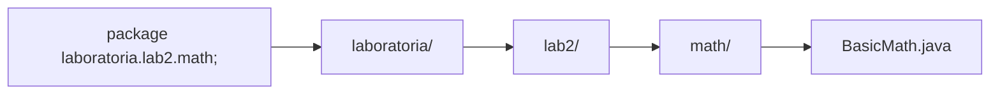
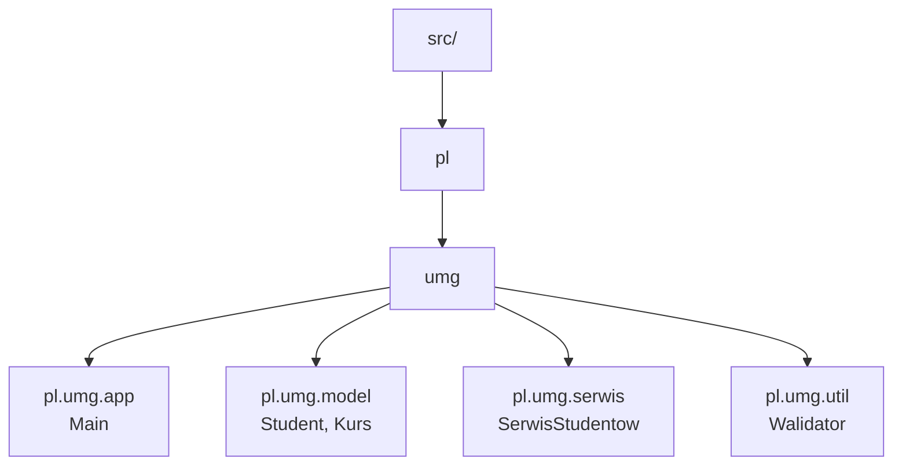
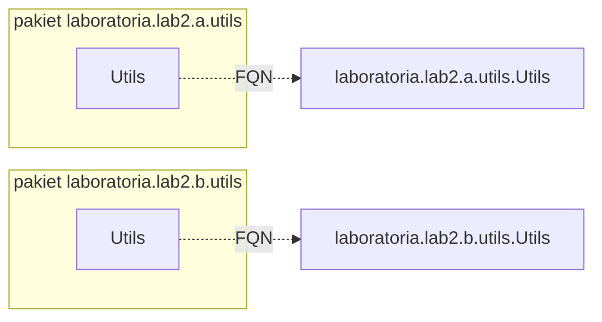
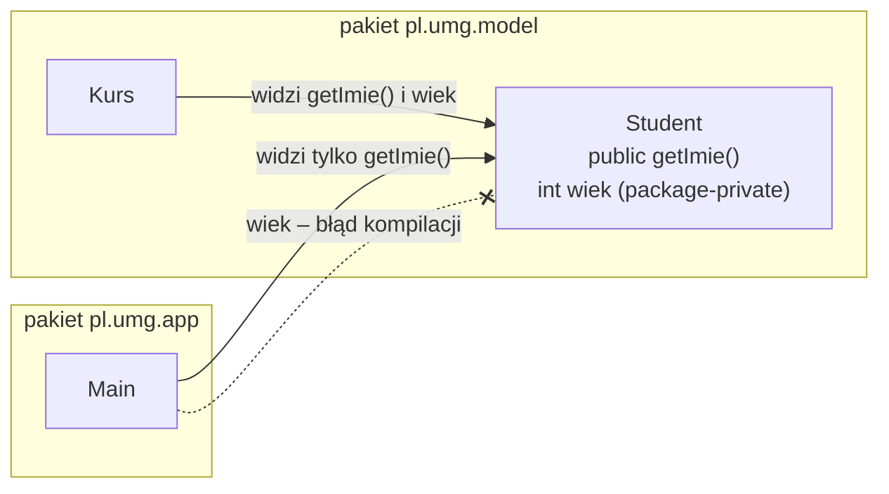
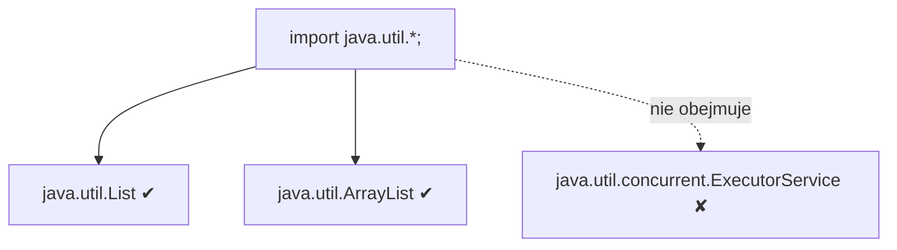
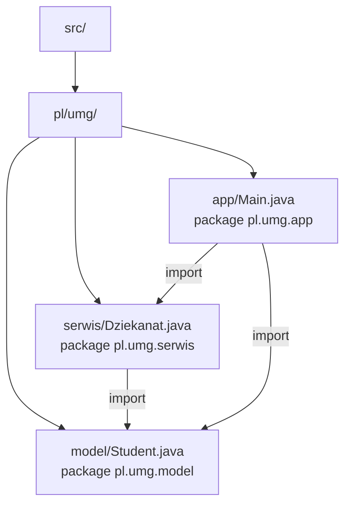
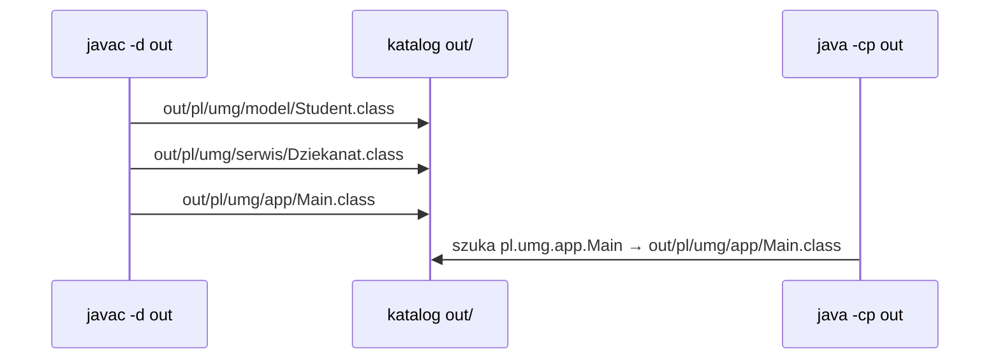

# Modułowość. Pakiety. Mechanizm importowania klas (Java)

Dokument stanowi krótkie kompendium wiedzy potrzebnej do pracy z większymi projektami w Javie. Zawiera teorię, praktyczne wskazówki oraz przykłady oparte na kodzie z folderu `laboratoria/lab2`.


## 1. Pakiety (packages)
Pakiet to logiczna przestrzeń nazw dla klas. Pozwala porządkować kod, zapobiegać konfliktom nazw i kontrolować widoczność.

- Deklaracja pakietu zawsze jest w pierwszej linii pliku źródłowego:
  ```java
  package laboratoria.lab2.math;
  ```
- Struktura katalogów musi odpowiadać nazwie pakietu (kropki → katalogi):
  - `laboratoria.lab2.math.BasicMath` → plik: `laboratoria/lab2/math/BasicMath.java`
- Konwencje nazewnicze:
  - małe litery, nazwa zaczyna się często od odwróconej domeny: `pl.umg.projekt.modul`
  - jednoznaczne i opisowe nazwy pakietów

Widoczność a pakiety:
- `public` — klasa/metoda/pole widoczne w całej aplikacji.
- brak modyfikatora (tzw. package-private) — widoczne tylko wewnątrz tego samego pakietu.
- `protected` — dla dziedziczenia; poza zakresem tego skrótu, ale warte zapamiętania.

Korzyści z pakietów:
- porządek i czytelność kodu,
- brak konfliktów nazw między pakietami (np. dwie klasy `Utils` w różnych pakietach),
- możliwość grupowania powiązanych tematów (np. `geometry`, `math`, `text`).

### 1.1. Pakiety na rysunkach

**Nazwa pakietu = ścieżka katalogów.** Każda kropka w nazwie pakietu odpowiada podkatalogowi:



**Hierarchia pakietów w przykładowym projekcie** (pakiety jak „szuflady” na klasy):



**Pakiet jako przestrzeń nazw** — dwie klasy `Utils` nie kolidują, bo ich pełne nazwy (FQN) są różne:



**Widoczność a pakiety** — element bez modyfikatora (package-private) widzą tylko klasy z tego samego pakietu:



**Import a podpakiety** — gwiazdka obejmuje tylko klasy bezpośrednio w pakiecie:




## 2. Mechanizm importowania klas
Import jest skrótem składniowym umożliwiającym używanie krótkich nazw klas zamiast pełnych kwalifikacji (FQN — Fully Qualified Name).

Rodzaje importów:
1) Import pojedynczej klasy:
   ```java
   import laboratoria.lab2.math.BasicMath; // tylko ta klasa
   ```
2) Import „z gwiazdką” (on-demand):
   ```java
   import laboratoria.lab2.geometry.*; // Point, DistanceUtils, itd.
   ```
   Uwaga: gwiazdka działa tylko na poziomie pakietu, nie obejmuje podpakietów.
3) Static import — import metod/pól statycznych bez podawania nazwy klasy:
   ```java
   import static laboratoria.lab2.math.BasicMath.add;
   import static laboratoria.lab2.math.BasicMath.*; // add, sub, mul, div, ...
   ```
4) Brak importu — użycie wprost pełnej nazwy klasy:
   ```java
   java.util.List<String> list = new java.util.ArrayList<>();
   ```

Kiedy import nie jest potrzebny:
- dla klas z tego samego pakietu,
- dla klas z pakietu `java.lang` (np. `String`, `Math`).

Potencjalne konflikty:
- Dwie klasy o tej samej nazwie z różnych pakietów — rozwiązanie: użyj FQN przynajmniej dla jednej z nich.


## 3. Modułowość (JPMS — Java Platform Module System)
Moduły wprowadzono w Javie 9. Moduł grupuje pakiety i jednoznacznie deklaruje zależności między modułami.

Cechy modułów:
- każdy moduł ma plik `module-info.java` w katalogu źródłowym modułu;
- definiuje, które pakiety są eksportowane (`exports`), i jakie moduły są wymagane (`requires`).

Przykładowy `module-info.java`:
```java
module pl.umg.lab2 {
    exports laboratoria.lab2.math;
    exports laboratoria.lab2.geometry;
    // requires inny.modul; // jeśli potrzebne
}
```

- `exports laboratoria.lab2.math;` — pakiet jest „publiczny” dla innych modułów.
- Jeśli pakiet nie jest eksportowany, jego publiczne klasy nie są widoczne poza modułem (public + nieeksportowany = w praktyce „wewnętrzny” w skali modułu).

Classpath vs module-path:
- tradycyjne projekty używają classpath (bez modułów),
- projekty modułowe kompiluje się i uruchamia z użyciem module-path i `module-info.java`.

W małych projektach edukacyjnych często wystarczy klasyczny układ z pakietami bez modułów. W większych — warto rozważyć JPMS dla lepszej enkapsulacji i kontroli zależności.


## 4. Przykłady (na bazie folderu laboratoria/lab2)

### 4.1. Import pojedynczych klas
Plik: `laboratoria/lab2/Zad1_DemoPakietow.java` (fragment ideowy)
```java
import laboratoria.lab2.math.BasicMath;
import laboratoria.lab2.geometry.Point;

public class Zad1_DemoPakietow {
    public static void main(String[] args) {
        int s = BasicMath.add(2, 3);
        Point p = new Point(1, 2);
        System.out.println("s = " + s + ", p = (" + p.x + ", " + p.y + ")");
    }
}
```

### 4.2. Wildcard import (pakiet, bez podpakietów)
```java
import laboratoria.lab2.geometry.*; // Point, DistanceUtils

public class PrzykladGeometry {
    public static void main(String[] args) {
        Point a = new Point(0, 0);
        Point b = new Point(3, 4);
        double d = DistanceUtils.distance(a, b); // 5.0
        System.out.println("d = " + d);
    }
}
```

### 4.3. Static import metod
```java
import static laboratoria.lab2.math.BasicMath.*; // add, sub, mul, div

public class PrzykladStaticImport {
    public static void main(String[] args) {
        int x = add(10, 5);      // zamiast BasicMath.add(10, 5)
        int y = mul(3, 7);
        System.out.println(x + ", " + y);
    }
}
```

### 4.4. Konflikt nazw — dwie klasy Utils w różnych pakietach
Plik: `laboratoria/lab2/Zad3_KonfliktNazw.java` (idea)
```java
import laboratoria.lab2.a.utils.Utils;        // Utils A
import laboratoria.lab2.b.utils.Utils as BUtils; // (Uwaga: w Javie nie ma aliasów! — to pseudokod)

public class KonfliktNazw {
    public static void main(String[] args) {
        // W Javie należy użyć pełnych nazw kwalifikowanych,
        // gdy istnieje konflikt nazw:
        laboratoria.lab2.a.utils.Utils.print("A");
        laboratoria.lab2.b.utils.Utils.print("B");
    }
}
```
Wyjaśnienie: Java NIE wspiera aliasów importów. Jeśli masz dwie klasy o tej samej nazwie, użyj pełnej nazwy pakietu w miejscu użycia.

### 4.5. Import a podpakiety
Import z pakietu nie obejmuje jego podpakietów. Przykładowo:
```java
import laboratoria.lab2.a.*; // nie importuje laboratoria.lab2.a.utils
```
Aby użyć klasy z `laboratoria.lab2.a.utils.Utils`, musisz:
```java
import laboratoria.lab2.a.utils.Utils;
```

### 4.6. Kompletny projekt z deklaracjami `package`
Struktura projektu:



```java
// Plik: src/pl/umg/model/Student.java
package pl.umg.model;

public class Student {
    private final String imie;
    private final double srednia;

    public Student(String imie, double srednia) {
        this.imie = imie;
        this.srednia = srednia;
    }

    public String getImie() { return imie; }
    public double getSrednia() { return srednia; }

    @Override
    public String toString() {
        return imie + " (" + srednia + ")";
    }
}
```

```java
// Plik: src/pl/umg/serwis/Dziekanat.java
package pl.umg.serwis;

import pl.umg.model.Student;

import java.util.ArrayList;
import java.util.List;

public class Dziekanat {
    private final List<Student> studenci = new ArrayList<>();

    public void zapisz(Student s) {
        studenci.add(s);
    }

    public List<Student> stypendysci(double prog) {
        List<Student> wynik = new ArrayList<>();
        for (Student s : studenci) {
            if (s.getSrednia() >= prog) {
                wynik.add(s);
            }
        }
        return wynik;
    }
}
```

```java
// Plik: src/pl/umg/app/Main.java
package pl.umg.app;

import pl.umg.model.Student;
import pl.umg.serwis.Dziekanat;

public class Main {
    public static void main(String[] args) {
        Dziekanat d = new Dziekanat();
        d.zapisz(new Student("Ala", 4.8));
        d.zapisz(new Student("Olek", 3.9));
        System.out.println("Stypendyści: " + d.stypendysci(4.5));
    }
}
```

Kompilacja i uruchomienie (z katalogu nadrzędnego wobec `src`):
```bash
javac -d out src/pl/umg/model/Student.java src/pl/umg/serwis/Dziekanat.java src/pl/umg/app/Main.java
java -cp out pl.umg.app.Main
```



### 4.7. Klasy z tego samego pakietu — bez importu
```java
// Plik: pl/umg/geometria/Punkt.java
package pl.umg.geometria;

public class Punkt {
    final double x, y; // package-private — widoczne w pl.umg.geometria

    public Punkt(double x, double y) {
        this.x = x;
        this.y = y;
    }
}
```

```java
// Plik: pl/umg/geometria/Odcinek.java
package pl.umg.geometria;

// brak importu — Punkt jest w tym samym pakiecie
public class Odcinek {
    private final Punkt a, b;

    public Odcinek(Punkt a, Punkt b) {
        this.a = a;
        this.b = b;
    }

    public double dlugosc() {
        // bezpośredni dostęp do pól package-private
        return Math.hypot(b.x - a.x, b.y - a.y);
    }
}
```

```java
// Plik: pl/umg/app/DemoGeometria.java
package pl.umg.app;

import pl.umg.geometria.Odcinek;
import pl.umg.geometria.Punkt;

public class DemoGeometria {
    public static void main(String[] args) {
        Odcinek o = new Odcinek(new Punkt(0, 0), new Punkt(3, 4));
        System.out.println("Długość: " + o.dlugosc()); // 5.0
        // new Punkt(1, 1).x;  // BŁĄD: pole x nie jest widoczne poza pakietem
    }
}
```

### 4.8. Ta sama nazwa klasy w dwóch pakietach
```java
// Plik: pl/umg/sklep/Zamowienie.java
package pl.umg.sklep;

public class Zamowienie {
    public String opis() { return "Zamówienie w sklepie"; }
}
```

```java
// Plik: pl/umg/magazyn/Zamowienie.java
package pl.umg.magazyn;

public class Zamowienie {
    public String opis() { return "Zamówienie dostawy do magazynu"; }
}
```

```java
// Plik: pl/umg/app/DemoKonflikt.java
package pl.umg.app;

import pl.umg.sklep.Zamowienie; // krótka nazwa = wersja ze sklepu

public class DemoKonflikt {
    public static void main(String[] args) {
        Zamowienie z1 = new Zamowienie();
        pl.umg.magazyn.Zamowienie z2 = new pl.umg.magazyn.Zamowienie(); // FQN
        System.out.println(z1.opis());
        System.out.println(z2.opis());
    }
}
```


## 5. Dobre praktyki
- Trzymaj strukturę katalogów w zgodzie z deklaracjami `package`.
- Unikaj nadmiernego używania wildcard importów w bibliotekach publicznych — utrudniają analizę zależności.
- W przypadku konfliktów nazw używaj pełnych nazw kwalifikowanych (FQN).
- Grupuj klasy według odpowiedzialności (np. `geometry`, `math`, `text`).
- W projektach większych rozważ JPMS (moduły) dla lepszej enkapsulacji i kontroli zależności.


## 6. Szybkie FAQ
- Czy muszę zawsze pisać `package`? — Tak, jeśli chcesz korzystać z pakietów. Klasy „bez pakietu” lądują w tzw. unnamed package — to niezalecane w większych projektach.
- Czy `import java.util.*;` importuje `java.util.concurrent.*`? — Nie. Gwiazdka nie sięga do podpakietów.
- Czy `public` w klasie wystarczy, żeby była dostępna wszędzie? — Tak w modelu classpath, ale w projektach modułowych dodatkowo pakiet musi być `exports` w `module-info.java`.


---
Materiał uzupełnia zadania i rozwiązania w folderze `laboratoria/lab2` i może służyć jako „ściąga” podczas ćwiczeń.

---

## 7. Materiał uzupełniający: notatki praktyczne do pakietów i importów

Poniższa część zachowuje dodatkowe wyjaśnienia, przykłady i ćwiczenia z wcześniejszego, osobnego pliku z notatkami. Dzięki temu cały temat modułowości, pakietów i importowania klas znajduje się w jednym miejscu.

### 7.1. Po co są pakiety?
Pakiety porządkują kod i tworzą przestrzeń nazw dla klas. Dzięki nim:
- unikamy konfliktów nazw (np. dwie klasy Utils w różnych pakietach),
- grupujemy powiązane tematy (np. geometry, math, text),
- kontrolujemy widoczność elementów (package-private vs public).

Konwencja nazewnicza: małe litery, zwykle odwrócona domena, np. pl.umg.projekt.modul. Struktura katalogów odpowiada nazwie pakietu (kropki -> podkatalogi).

Przykład deklaracji na górze pliku źródłowego:
```java
package laboratoria.lab2.math;
```

Plik powinien znaleźć się pod ścieżką: `laboratoria/lab2/math/NazwaKlasy.java`

### 7.2. Importowanie klas - rodzaje i kiedy używać
Import pozwala używać krótkich nazw klas zamiast pełnych kwalifikacji (FQN - Fully Qualified Name).

Najczęstsze warianty:
1) Import pojedynczej klasy:
```java
import laboratoria.lab2.math.BasicMath; // tylko ta klasa
```

2) Import wieloznaczny (z "gwiazdką"):
```java
import laboratoria.lab2.geometry.*; // Point, DistanceUtils, itp.
```
Uwaga: gwiazdka dotyczy tylko danego pakietu - nie obejmuje podpakietów.

3) Static import (metody/pola statyczne bez nazwy klasy):
```java
import static laboratoria.lab2.math.BasicMath.add;
import static laboratoria.lab2.math.BasicMath.*; // add, sub, mul, div, ...
```

4) Bez importu - użycie pełnej nazwy:
```java
java.util.List<String> list = new java.util.ArrayList<>();
```

Import nie jest potrzebny, gdy:
- klasa jest w tym samym pakiecie,
- klasa pochodzi z `java.lang` (np. `String`, `Math`).

### 7.3. Przykłady praktyczne

#### A) Import pojedynczych klas
```java
import laboratoria.lab2.math.BasicMath;
import laboratoria.lab2.geometry.Point;

public class DemoA {
    public static void main(String[] args) {
        int s = BasicMath.add(2, 3);
        Point p = new Point(1, 2);
        System.out.println("s = " + s + ", p = " + p);
    }
}
```

#### B) Import z gwiazdką (pakiet, bez podpakietów)
```java
import laboratoria.lab2.geometry.*; // Point, DistanceUtils

public class DemoB {
    public static void main(String[] args) {
        Point a = new Point(0, 0);
        Point b = new Point(3, 4);
        double d = DistanceUtils.distance(a, b);
        System.out.println("d = " + d); // 5.0
    }
}
```

#### C) Static import metod
```java
import static laboratoria.lab2.math.BasicMath.*; // add, sub, mul, div
import static laboratoria.lab2.geometry.DistanceUtils.distance;
import laboratoria.lab2.geometry.Point;

public class DemoC {
    public static void main(String[] args) {
        int x = add(10, 5);   // zamiast BasicMath.add(10, 5)
        int y = mul(3, 7);
        System.out.println(x + ", " + y);

        Point p1 = new Point(0, 0);
        Point p2 = new Point(6, 8);
        System.out.println("dist = " + distance(p1, p2)); // 10.0
    }
}
```

#### D) Konflikt nazw (dwie klasy Utils w różnych pakietach)
W Javie nie ma aliasów importów dla klas. Jesli wystapi konflikt nazw, użyj pełnej nazwy kwalifikowanej (FQN) przynajmniej dla jednej z klas:
```java
public class DemoD {
    public static void main(String[] args) {
        String aName = laboratoria.lab2.a.utils.Utils.name();
        String bName = laboratoria.lab2.b.utils.Utils.name();
        System.out.println(aName);
        System.out.println(bName);
    }
}
```

#### E) Import a podpakiety
```java
import laboratoria.lab2.a.*; // nie importuje laboratoria.lab2.a.utils
// Aby korzystać z klasy Utils w podpakiecie:
import laboratoria.lab2.a.utils.Utils;
```

### 7.4. Najczęstsze błędy i pułapki
- Niezgodność `package` <-> ścieżka katalogów (błąd kompilacji).
- Przekonanie, że import z gwiazdką obejmuje podpakiety - nie obejmuje.
- Konflikty nazw przy wielu bibliotekach: bez aliasów; używamy FQN.
- Zbyt agresywne wildcardy utrudniają analizę zależności w dużych projektach.

### 7.5. Dobre praktyki
- Trzymaj strukturę katalogów w zgodzie z deklaracjami `package`.
- W kodzie bibliotecznym preferuj jawne importy nad wildcardami.
- Grupuj klasy według odpowiedzialności (math, geometry, text, ...).
- Dokumentuj nietypowe decyzje (np. FQN z powodu konfliktów nazw).

### 7.6. Mini-cwiczenia
1) Dodaj klasę `TextStats` w pakiecie `laboratoria.lab2.text` z metodą `countWords(String s)`. Użyj jej w małej klasie demo.
2) Utwórz dwa pakiety z klasą `Helper` w każdym i pokaż, jak odwołać się do obu przy pomocy FQN.
3) Dla praktyki ze static import przepnij wywołania `BasicMath.add/sub/mul/div` na formę bez nazwy klasy.

### 7.7. FAQ
- Czy muszę wpisywać `package` na górze każdego pliku? Tak, jeśli chcesz używać pakietów (unikaj unnamed package).
- Czy `import java.util.*;` importuje `java.util.concurrent.*`? Nie - podpakiety nie są objęte wildcardem.
- Czy `public` wystarczy, by klasa była widoczna wszędzie? W modelu classpath tak, ale w projektach modułowych dodatkowo pakiet musi być eksportowany w `module-info.java`.

---
Notatki powstały na podstawie materiału z kursjava.com; zachęcam do lektury źródła dla szerszego kontekstu i dodatkowych przykładów.
