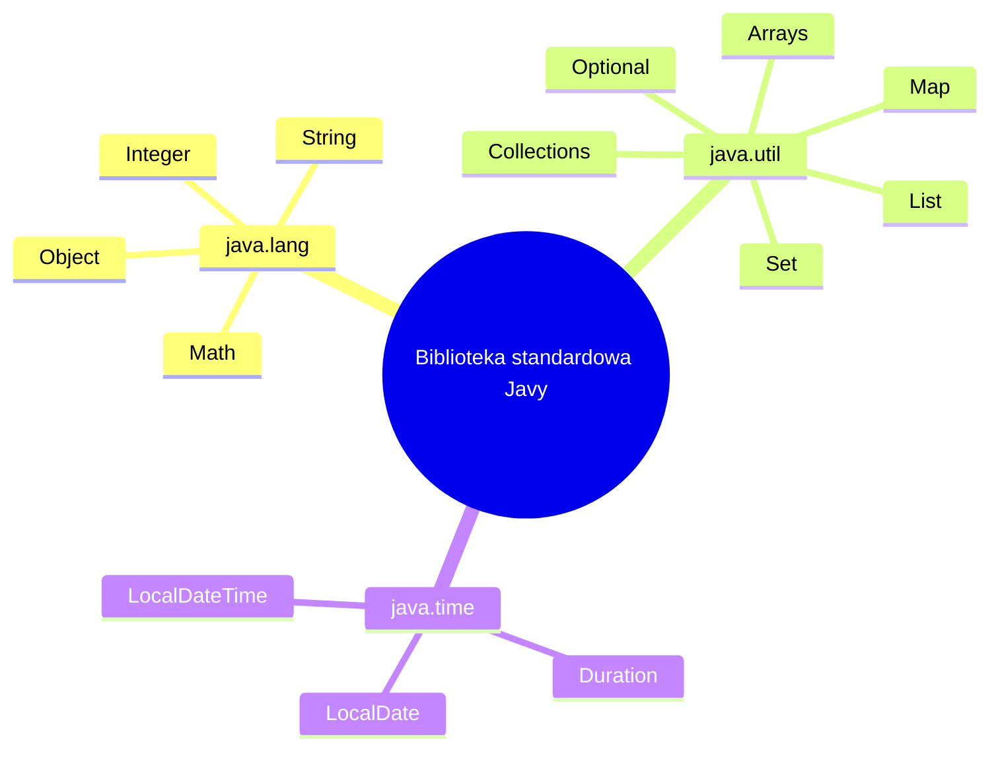
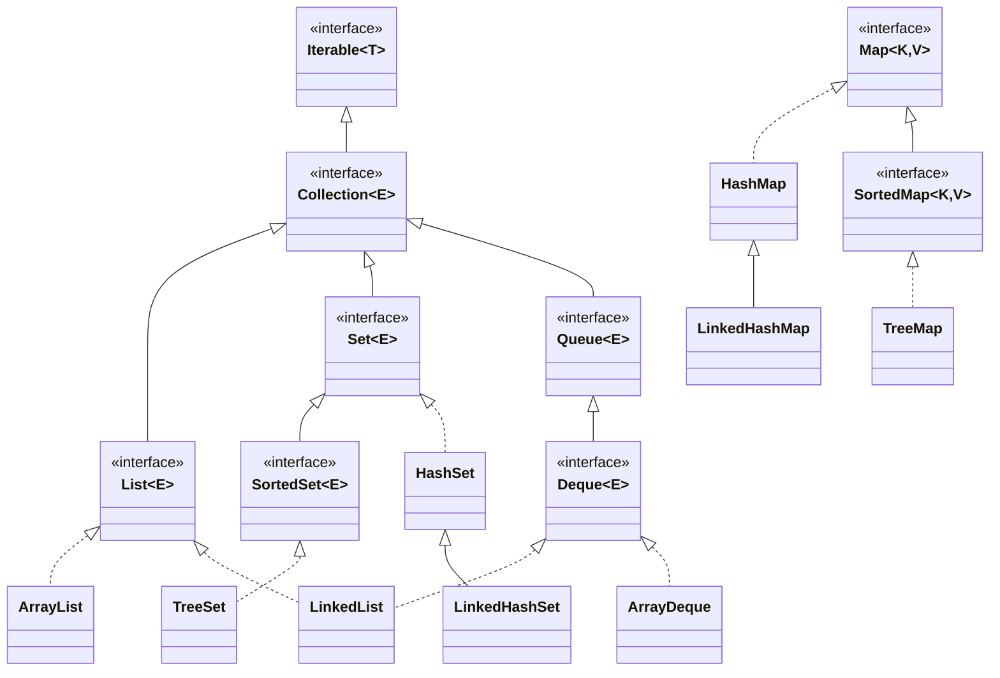

# Wykład 10: Podstawowe klasy biblioteki Java

## Spis treści

- [1. Po co znać bibliotekę standardową?](#1-po-co-znać-bibliotekę-standardową)
- [2. Klasa `Object` - wspólny przodek wszystkich klas](#2-klasa-object---wspólny-przodek-wszystkich-klas)
- [3. `String` - niemutowalny typ tekstowy](#3-string---niemutowalny-typ-tekstowy)
- [4. `StringBuilder` - wydajne budowanie tekstu](#4-stringbuilder---wydajne-budowanie-tekstu)
- [5. Klasy opakowujące: `Integer`, `Double`, `Boolean`](#5-klasy-opakowujące-integer-double-boolean)
- [6. `Math` - operacje matematyczne](#6-math---operacje-matematyczne)
- [7. Tablice oraz klasa `Arrays`](#7-tablice-oraz-klasa-arrays)
- [8. Kolekcje: `List`, `Set`, `Map`](#8-kolekcje-list-set-map)
- [9. `Collections` i operacje pomocnicze](#9-collections-i-operacje-pomocnicze)
- [10. `Optional<T>`](#10-optionalt)
- [11. API dat i czasu: `java.time`](#11-api-dat-i-czasu-javatime)
- [12. Dobre praktyki](#12-dobre-praktyki)
- [13. Mini-zadania](#13-mini-zadania)
- [14. Podsumowanie](#14-podsumowanie)
- [Uzupełnienia](#uzupełnienia)
- [Podsumowanie](#podsumowanie)
- [Pytania kontrolne](#pytania-kontrolne)
- [Laboratorium](#laboratorium)

Ten moduł porządkuje najważniejsze klasy i interfejsy biblioteki standardowej Javy, z którymi student spotyka się niemal od razu przy pisaniu kodu obiektowego. Celem nie jest omówienie całego API, ale zrozumienie najczęściej używanych narzędzi i ich roli w projektowaniu klas.

## 1. Po co znać bibliotekę standardową?

W programowaniu obiektowym nie tworzymy wszystkiego od zera. Biblioteka standardowa:
- dostarcza sprawdzone abstrakcje,
- zmniejsza liczbę błędów,
- upraszcza kod,
- ujednolica styl pracy w projektach.

Zamiast pisać własną listę, mapę, klasę do daty albo parser liczb, zwykle korzystamy z gotowych elementów Javy.



## 2. Klasa `Object` - wspólny przodek wszystkich klas

Każda klasa w Javie dziedziczy po `Object`, nawet jeśli nie zapisujemy tego jawnie.

Najważniejsze metody:
- `toString()` - tekstowa reprezentacja obiektu,
- `equals(Object other)` - porównywanie obiektów logicznie,
- `hashCode()` - wsparcie dla struktur haszujących,
- `getClass()` - informacja o typie w czasie działania.

Przykład:

```java
public class Book {
    private final String title;
    private final String author;

    public Book(String title, String author) {
        this.title = title;
        this.author = author;
    }

    @Override
    public String toString() {
        return "Book{title='" + title + "', author='" + author + "'}";
    }
}
```

Wnioski praktyczne:
- własne klasy warto wyposażać w sensowne `toString()`,
- jeśli obiekty mają być porównywane "po zawartości", trzeba przemyśleć `equals()` i `hashCode()`,
- `Object` jest fundamentem polimorfizmu i kolekcji.

## 3. `String` - niemutowalny typ tekstowy

`String` jest jedną z najważniejszych klas w Javie.

Cechy:
- jest niemutowalny (`immutable`),
- bezpieczny do współdzielenia,
- wspiera wiele metod pomocniczych, np. `length()`, `substring()`, `contains()`, `equals()`, `toLowerCase()`.

```java
String firstName = "Anna";
String lastName = "Nowak";
String fullName = firstName + " " + lastName;

System.out.println(fullName.length());
System.out.println(fullName.toUpperCase());
System.out.println(fullName.contains("Now"));
```

Ważna uwaga:
- do porównywania napisów używamy `equals()`, nie `==`.

```java
String a = new String("Java");
String b = new String("Java");

System.out.println(a == b);      // false
System.out.println(a.equals(b)); // true
```

## 4. `StringBuilder` - wydajne budowanie tekstu

Jeśli łączymy napisy w pętli, lepiej użyć `StringBuilder`.

```java
StringBuilder sb = new StringBuilder();

for (int i = 1; i <= 3; i++) {
    sb.append("Linia ");
    sb.append(i);
    sb.append('\n');
}

String result = sb.toString();
System.out.println(result);
```

Kiedy używać:
- raporty tekstowe,
- eksport CSV,
- składanie większych komunikatów,
- wielokrotne dopisywanie fragmentów tekstu.

## 5. Klasy opakowujące: `Integer`, `Double`, `Boolean`

Typy prymitywne (`int`, `double`, `boolean`) nie są obiektami. Ich odpowiedniki obiektowe to:
- `Integer`,
- `Double`,
- `Boolean`,
- `Long`, `Float`, `Character`, `Byte`, `Short`.

Przykład:

```java
Integer x = 10;      // autoboxing
int y = x + 5;       // auto-unboxing

double value = Double.parseDouble("3.14");
int number = Integer.parseInt("42");
```

W praktyce są potrzebne m.in.:
- w kolekcjach (`List<Integer>`),
- w generics,
- przy parsowaniu danych wejściowych.

## 6. `Math` - operacje matematyczne

Klasa `Math` udostępnia statyczne metody pomocnicze.

```java
double radius = 3.0;
double area = Math.PI * Math.pow(radius, 2);

System.out.println(Math.sqrt(25));
System.out.println(Math.max(10, 15));
System.out.println(area);
```

Najczęściej używane metody:
- `abs`,
- `max`, `min`,
- `pow`,
- `sqrt`,
- `round`,
- `random`.

## 7. Tablice oraz klasa `Arrays`

Tablica ma stały rozmiar. Gdy rozmiar danych się zmienia, zwykle lepiej użyć kolekcji.

```java
int[] values = {4, 1, 7, 2};
Arrays.sort(values);
System.out.println(Arrays.toString(values));
```

Przydatne metody:
- `Arrays.sort(...)`,
- `Arrays.toString(...)`,
- `Arrays.copyOf(...)`,
- `Arrays.asList(...)`.

```java
String[] names = {"Jan", "Anna", "Ola"};
String[] copy = Arrays.copyOf(names, names.length);
System.out.println(Arrays.toString(copy));
```

## 8. Kolekcje: `List`, `Set`, `Map`

### `List`
Uporządkowana kolekcja elementów, dopuszcza duplikaty.

```java
List<String> students = new ArrayList<>();
students.add("Anna");
students.add("Piotr");
students.add("Anna");

System.out.println(students.get(0));
System.out.println(students.size());
```

### `Set`
Zbiór unikalnych elementów.

```java
Set<String> tags = new HashSet<>();
tags.add("java");
tags.add("oop");
tags.add("java");

System.out.println(tags.size()); // 2
```

### `Map`
Struktura klucz-wartość.

```java
Map<String, Integer> points = new HashMap<>();
points.put("Anna", 10);
points.put("Piotr", 8);

System.out.println(points.get("Anna"));
System.out.println(points.containsKey("Piotr"));
```

Porównanie:

| Struktura | Przechowuje | Duplikaty | Typowe użycie |
|---|---|---|---|
| `List` | sekwencję | tak | lista studentów, historia zdarzeń |
| `Set` | zbiór | nie | unikalne tagi, role użytkownika |
| `Map` | pary klucz-wartość | klucze nie | słownik danych, konfiguracja |

## 9. `Collections` i operacje pomocnicze

Klasa `Collections` zawiera metody użytkowe do pracy z kolekcjami.

```java
List<Integer> numbers = new ArrayList<>(Arrays.asList(3, 1, 2));
Collections.sort(numbers);
Collections.reverse(numbers);

System.out.println(numbers);
```

Warto znać:
- `sort`,
- `reverse`,
- `shuffle`,
- `unmodifiableList`.

## 10. `Optional<T>`

`Optional` pomaga wyrazić, że wynik może istnieć albo nie.

```java
Optional<String> email = Optional.of("anna@example.com");
System.out.println(email.orElse("brak"));

Optional<String> emptyEmail = Optional.empty();
System.out.println(emptyEmail.orElse("brak"));
```

Przykład użycia:

```java
public Optional<Student> findByIndex(String index) {
    if ("12345".equals(index)) {
        return Optional.of(new Student("Anna"));
    }
    return Optional.empty();
}
```

`Optional` nie zastępuje wszystkich wyjątków i nie powinien być nadużywany jako pole każdej klasy. Dobrze sprawdza się głównie jako typ zwracany z metod wyszukujących.

## 11. API dat i czasu: `java.time`

Nowoczesne API dat jest dużo bezpieczniejsze niż stare klasy `Date` i `Calendar`.

Najważniejsze typy:
- `LocalDate`,
- `LocalTime`,
- `LocalDateTime`,
- `Duration`,
- `Period`.

```java
LocalDate today = LocalDate.now();
LocalDate examDate = LocalDate.of(2026, 7, 15);

System.out.println(today);
System.out.println(examDate.isAfter(today));
```

Przykład z `Duration`:

```java
LocalDateTime start = LocalDateTime.of(2026, 7, 5, 10, 0);
LocalDateTime end = LocalDateTime.of(2026, 7, 5, 12, 30);

Duration duration = Duration.between(start, end);
System.out.println(duration.toMinutes()); // 150
```

## 12. Dobre praktyki

- Najpierw szukaj rozwiązania w bibliotece standardowej, dopiero potem pisz własną implementację.
- Używaj właściwej struktury danych do problemu.
- Nie porównuj napisów przez `==`.
- Jeśli klasa ma być używana w kolekcjach haszujących, przemyśl `equals()` i `hashCode()`.
- Nie twórz własnego systemu dat i czasu.
- `Optional` traktuj jako narzędzie do zwracania wyniku opcjonalnego, nie jako modę.

## 13. Mini-zadania

1. Napisz klasę `Book`, która nadpisuje `toString()` i przechowuje tytuł oraz autora.
2. Utwórz `List<Integer>`, posortuj ją i wypisz największy element.
3. Zbuduj `Map<String, Double>` przechowującą ceny produktów i oblicz średnią cenę.
4. Napisz metodę, która przyjmuje `String[]` i zwraca posortowaną kopię tablicy.
5. Użyj `LocalDate` do sprawdzenia, ile dni zostało do egzaminu.

## 14. Podsumowanie

Znajomość podstawowych klas biblioteki Javy jest częścią dojrzałego programowania obiektowego. Student powinien rozumieć:
- które klasy reprezentują stan i dane,
- które służą do organizacji kolekcji,
- które wspierają pracę pomocniczą,
- oraz kiedy lepiej użyć gotowej abstrakcji niż dopisywać własny kod.

---

## Uzupełnienia

### Hierarchia kolekcji



`Map` nie dziedziczy po `Collection`, ale należy do tego samego frameworku kolekcji.

### Porównanie najczęściej używanych kolekcji

| Kolekcja | Kolejność | Duplikaty | `null` | Dostęp / wyszukiwanie | Dodawanie |
|---|---|---|---|---|---|
| `ArrayList` | wstawiania | tak | tak | `get(i)` O(1), `contains` O(n) | O(1) na końcu (amort.) |
| `LinkedList` | wstawiania | tak | tak | `get(i)` O(n) | O(1) na początku/końcu |
| `HashSet` | brak gwarancji | nie | jeden | `contains` O(1) | O(1) |
| `LinkedHashSet` | wstawiania | nie | jeden | O(1) | O(1) |
| `TreeSet` | posortowana | nie | nie | O(log n) | O(log n) |
| `HashMap` | brak gwarancji | klucze unikalne | jeden klucz `null` | `get` O(1) | O(1) |
| `LinkedHashMap` | wstawiania | klucze unikalne | tak | O(1) | O(1) |
| `TreeMap` | posortowana wg kluczy | klucze unikalne | brak klucza `null` | O(log n) | O(log n) |

### Nowoczesne udogodnienia

#### Fabryki `List.of`, `Set.of`, `Map.of` (Java 9+)

```java
List<String> dni = List.of("pon", "wt", "śr");          // niemodyfikowalna
Set<Integer> liczby = Set.of(1, 2, 3);
Map<String, Integer> oceny = Map.of("Ala", 5, "Ola", 4);
// dni.add("czw");   // UnsupportedOperationException
List<String> kopia = new ArrayList<>(dni);               // modyfikowalna kopia
```

#### Wnioskowanie typu `var` (Java 10+)

```java
var lista = new ArrayList<String>();      // typ: ArrayList<String>
var mapa = new HashMap<String, List<Integer>>();
for (var wpis : mapa.entrySet()) { ... }
```

`var` działa tylko dla zmiennych lokalnych z inicjalizatorem; typ jest nadal statyczny.

#### Bloki tekstowe — text blocks (Java 15+)

```java
String json = """
        {
          "imie": "Anna",
          "wiek": 21
        }
        """;
```

### Dodatek: List, ArrayList, Map, StringBuilder

Poniżej krótkie przypomnienie najczęściej używanych typów pomocniczych w Javie, które pojawiają się w zadaniach tego laboratorium, wraz z przykładami bez użycia lambd/Stream API.

#### List<T> i ArrayList<T>
- `List<T>` to interfejs, a `ArrayList<T>` to jedna z jego popularnych implementacji (tablica dynamiczna).
- Najczęstsze operacje: `add`, `get`, `set`, `remove`, `size`, iteracja pętlą `for-each`.

Przykład (Zadanie 1 — lista elementów `Drukowalne`):

```java
import java.util.List;
import java.util.ArrayList;

List<Drukowalne> lista = new ArrayList<Drukowalne>(); // można też: new ArrayList<>()
lista.add(new Raport("Wyniki kwartalne"));
lista.add(new Faktura(1234.56));

for (Drukowalne d : lista) {
    d.drukuj();
}
```

Przykład (Zadanie 3 — sumowanie pól figur):

```java
import java.util.ArrayList;
import java.util.List;

List<Figura> figury = new ArrayList<Figura>();
figury.add(new Kolo(2.0));
figury.add(new Prostokat(3.0, 4.0));

double sumaPol = 0.0;
for (Figura f : figury) {
    sumaPol += f.pole();
}
System.out.println("Suma pól = " + sumaPol);
```

Kilka uwag:
- Operator diamentowy `<>` może być użyty po prawej stronie: `new ArrayList<>()` — typ wynikowy jest wywnioskowany.
- `ArrayList` zachowuje kolejność dodawania elementów i pozwala na szybki dostęp przez indeks (`get`).
- Jeśli potrzebujesz kolejki/dwukierunkowej listy, alternatywą bywa `LinkedList<T>` (nie jest wymagana w tym labie, ale warto wiedzieć).

#### Map<K, V> (np. HashMap)
- `Map<K, V>` przechowuje pary klucz–wartość. Najczęściej używana implementacja to `HashMap<K, V>`.
- Operacje: `put`, `get`, `containsKey`, `remove`, iteracja po `entrySet()`.

Przykład (Zadanie 4 — przechowywanie cen produktów w sklepie):

```java
import java.util.HashMap;
import java.util.Map;

Map<String, Double> ceny = new HashMap<String, Double>();
ceny.put("jabłko", 1.99);
ceny.put("gruszka", 2.49);

if (ceny.containsKey("jabłko")) {
    double cena = ceny.get("jabłko");
    System.out.println("Cena jabłka: " + cena);
}

// Iteracja po parach klucz–wartość
for (Map.Entry<String, Double> e : ceny.entrySet()) {
    String nazwa = e.getKey();
    Double cena = e.getValue();
    System.out.println(nazwa + " -> " + cena);
}
```

Uwagi:
- `HashMap` nie gwarantuje kolejności. Jeśli kolejność ma znaczenie, można użyć `LinkedHashMap` (kolejność wstawiania) lub `TreeMap` (kolejność naturalna kluczy).
- Klucze w `Map` powinny mieć dobrze zdefiniowane `equals` i `hashCode` (dla `HashMap`). Dla typów wbudowanych (`String`, `Integer`) jest już to gotowe.

#### StringBuilder
- Służy do wydajnego budowania łańcuchów znaków w pętli lub przy wielu konkatenacjach.
- Metody: `append`, `toString`. Zazwyczaj szybszy niż wielokrotne użycie operatora `+` w pętli.

Przykład (Zadanie 5 — budowanie treści raportu CSV/JSON):

```java
public class RaportCSV /* extends RaportGenerator */ {
    // ...
    public String zbudujTresc() {
        StringBuilder sb = new StringBuilder();
        sb.append("kol1");
        sb.append(',');
        sb.append("kol2");
        sb.append('\n');
        sb.append("1");
        sb.append(',');
        sb.append("2");
        return sb.toString();
    }
}
```

Prosty przykład łączenia linii:

```java
StringBuilder sb = new StringBuilder();
for (int i = 0; i < 3; i++) {
    sb.append("linia ");
    sb.append(i);
    sb.append('\n');
}
String wynik = sb.toString();
System.out.println(wynik);
```

#### Arrays i Collections — przydatne narzędzia
- `java.util.Arrays` zawiera metody pomocnicze do pracy z tablicami (np. `Arrays.asList`, `Arrays.sort`).
- `java.util.Collections` zawiera metody narzędziowe dla kolekcji (`Collections.sort`, `Collections.shuffle`, `Collections.unmodifiableList`, itp.).

Przykład tworzenia listy startowej i sortowania (bez lambd):

```java
import java.util.*;

List<Integer> liczby = new ArrayList<Integer>(Arrays.asList(3, 1, 2));
Collections.sort(liczby); // naturalny porządek rosnący
System.out.println(liczby); // [1, 2, 3]
```

Jeśli potrzebujesz własnego kryterium sortowania bez lambd, możesz użyć anonimowego `Comparator`:

```java
import java.util.*;

List<String> slowa = new ArrayList<String>();
slowa.add("bbb");
slowa.add("a");
slowa.add("cc");

Collections.sort(slowa, new Comparator<String>() {
    public int compare(String s1, String s2) {
        return s1.length() - s2.length(); // sortuj po długości
    }
});
System.out.println(slowa); // [a, cc, bbb]
```

#### Typy opakowujące (wrappery) i generics
- W kolekcjach używamy typów referencyjnych (np. `Integer`, `Double`) zamiast prymitywów (`int`, `double`). Autoboxing/auto-unboxing dzieje się automatycznie.
- `List<Double>` oznacza listę obiektów `Double`. Zapisy typu „surowego” (`List lista = ...`) unikamy — tracimy wtedy bezpieczeństwo typów.

#### Iteracja: for-each i iterator
- Najprostsza iteracja: pętla `for-each` jak w przykładach powyżej.
- Dostępny jest też jawny `Iterator<T>`:

```java
import java.util.Iterator;

Iterator<Figura> it = figury.iterator();
while (it.hasNext()) {
    Figura f = it.next();
    System.out.println(f.pole());
}
```

---

---

## Podsumowanie

| Pojęcie | Znaczenie |
|---|---|
| `String` / `StringBuilder` | napis niemutowalny / mutowalny |
| `equals` / `hashCode` | równość logiczna i spójny skrót |
| `List` / `Set` / `Map` | lista / zbiór unikalnych / słownik |
| klasy opakowujące | `Integer`, `Double`… i autoboxing |

## Pytania kontrolne

1. Dlaczego `String` jest niemutowalny?
2. Jaki jest kontrakt między `equals` a `hashCode`?
3. Kiedy wybrać `HashMap`, a kiedy `TreeMap`?
4. Czym różni się `List.of` od `new ArrayList<>()`?

## Laboratorium

Zadania praktyczne do tego wykładu: [Laboratorium 10](../labs-OOP-in-Java/10-podstawowe-klasy-biblioteki-java.md)
